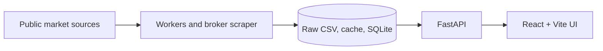

# Trade Lab

Trade Lab is a self-hosted research dashboard for Taiwan equities. It combines a React interface, a FastAPI service, and scheduled data workers to explore stocks, market breadth, industry rotation, broker-branch activity, monthly revenue, ETFs, and strategy results. The application runs locally or on a NAS; it does not place trades.

> **Data availability:** The source repository is not a complete market-data distribution. Most raw reports, caches, generated databases, logs, and backups are kept outside Git. A fresh clone can start the application, but data-driven pages may be empty until their sources are populated. External data providers can also be delayed, unavailable, or change their page formats.

## What is in the app?

| Area | What it shows |
| --- | --- |
| Market dashboard | Benchmarks, market breadth, limit-up/limit-down stocks, industry activity, recent revenue coverage, watchlists, and upcoming company events. |
| Stock detail | Company information, price and volume history, financial trends, monthly revenue, institutional flows, margin/short data, ownership distribution, and industry classification where data is available. |
| Industry and rotation | Sector/theme membership, fine-grained electronics classification, rotation rankings, constituent stocks, and historical context. |
| Broker branches | Imported TWSE broker CSV summaries, branch rankings, and the stocks bought or sold by a selected branch. |
| Revenue and ETFs | Monthly revenue momentum rankings and active ETF snapshots and holding changes. |
| Research tools | Strong-stock screens, configurable scans and historical backtests, a US market calendar, and background news-analysis jobs. |

The UI is primarily in Traditional Chinese. Individual views report missing or incomplete data instead of silently treating it as zero.

## Architecture



| Directory | Purpose |
| --- | --- |
| [`apps/web/`](apps/web/) | React and TypeScript frontend, built by Vite and served by nginx in the NAS deployment. |
| [`apps/api/`](apps/api/) | FastAPI endpoints for data reads and selected background jobs. |
| [`apps/worker/`](apps/worker/) | Daily refreshes, broker CSV imports, price updates, and database backups. |
| [`broker_scraper/`](broker_scraper/) | Separate TWSE broker-report downloader and its NAS schedule. |
| [`modules/`](modules/) | Shared data-source, industry, backtest, and research logic. |
| [`services/`](services/) | Dashboard and company-event services. |
| [`scripts/`](scripts/) | Local development, data setup, backfills, and NAS utilities. |
| [`docs/`](docs/) | Detailed design and operations notes. |

The worker writes the data files; the web app reads them through the API. SQLite and generated files live under a configurable data directory. The legacy Streamlit implementation is retained in [`archive/legacy_streamlit/`](archive/legacy_streamlit/) for reference and is not the current web entry point.

## Run locally

### Prerequisites

- Python compatible with [`requirements.txt`](requirements.txt), Node.js and npm, and a shell with `make`.
- Network access for data-refresh commands that query external sources.
- Local datasets if you want populated research views. See [Data and persistence](#data-and-persistence).

From the repository root:

```bash
python3 -m venv stock_env
stock_env/bin/python -m pip install -r requirements.txt
cd apps/web && npm ci && cd ../..
make dev
```

Open <http://127.0.0.1:5173>. The API health endpoint is <http://127.0.0.1:8000/health>, and interactive API documentation is at <http://127.0.0.1:8000/docs>. `make dev` starts both services; `make api` and `make web` start them separately. The Vite development server proxies `/api` to the local API. To use a different API origin, copy [`apps/web/.env.example`](apps/web/.env.example) to `apps/web/.env.local` and set `VITE_API_BASE_URL`.

Useful checks:

```bash
make build              # TypeScript check and production frontend build
make check              # Quick Python compile check and frontend build
curl -fsS http://127.0.0.1:8000/api/runtime/data-status
```

The local scripts default to `stock_env/bin/python`. If your interpreter is elsewhere, set `PYTHON_BIN` for `make` or `TRADE_PYTHON` when invoking the scripts directly.

## Data and persistence

The default local data directory is `data/`. The NAS deployment mounts persistent directories into its containers:

```text
data/
  db/                 SQLite databases on NAS
  raw/                Source reports, including broker/twse/<trade-date>/*.csv
  processed/          Derived datasets
  cache/              Refreshable caches
logs/                  Worker, scraper, and import logs
backups/               Database backups
```

`TRADE_DATA_DIR`, `TRADE_DB_DIR`, `TRADE_RAW_DATA_DIR`, `TRADE_PROCESSED_DATA_DIR`, `TRADE_CACHE_DIR`, `TRADE_LOGS_DIR`, and `TRADE_BACKUPS_DIR` override those paths. The API reports its effective paths and file availability at `/api/runtime/data-status`.

Some small reference files are tracked in Git, but a Git clone alone does not provide a complete working dataset. For an initial NAS migration, [`scripts/snapshot_nas_data.py`](scripts/snapshot_nas_data.py) makes consistent SQLite copies; transfer its output separately from the code. Do not copy a live SQLite file without a snapshot or online backup. Generated reports and private `.env` files should remain outside Git.

Data comes from sources including TWSE, TPEx, MOPS, TDCC, and configured price-data providers. Each dataset has its own publication schedule and coverage. See the source-specific notes under [`docs/`](docs/) for definitions and limitations.

## Scheduled updates and broker data

The main NAS scheduler in [`apps/worker/nas_scheduler.py`](apps/worker/nas_scheduler.py) runs the daily data pipeline on weekdays and handles separate company-event and broker-import slots. Its state and heartbeat are written under `logs/`. A dry run of the daily worker is available with:

```bash
stock_env/bin/python -m apps.worker.daily_update --dry-run
```

The broker downloader is a **separate service**. It checks the latest TWSE report date, enumerates listed stocks, validates each downloaded CSV, skips existing valid files, and records per-stock failures. It runs at 19:00 Asia/Taipei and can retry a failed run later, as configured by `BROKER_DAILY_TIME` and `BROKER_RETRY_TIME`. Its data goes to `data/raw/broker/twse/<trade-date>/`; its daily log and state are under `logs/broker_scraper/`.

Downloading CSVs and importing them for the web UI are different steps. The main worker imports only reports missing from the broker database and uses the shared download lock so it does not import during a download. Check both the scraper log and `logs/nas_broker_import.json` when broker rankings are missing. See the [broker scraper guide](broker_scraper/README.md) and [deployment guide](docs/DEPLOYMENT.md).

The TWSE site uses a CAPTCHA and can change its HTML or interrupt connections. A run may therefore finish with some stocks still missing. Consult the final `新增 / 無資料 / 失敗` summary in that day's log; do not infer success from the mere presence of a CSV directory.

## NAS deployment

The production Compose stack in [`compose.yaml`](compose.yaml) contains the API, web server, and main scheduler. The broker downloader has its own [`broker_scraper/compose.yaml`](broker_scraper/compose.yaml) and shares only the persistent data and log directories. Docker Compose and a prepared data snapshot are required for an initial installation.

1. Prepare a persistent installation root on the NAS with `data/`, `logs/`, and `backups/`.
2. Create a private `.env` from [`.env.example`](.env.example). Set `TRADE_NAS_ROOT` to that installation root, and set an appropriate `TRADE_BIND_IP` and port. Keep `.env` out of Git.
3. Transfer a consistent data snapshot separately from the code. The initial deployment requires the stock database and sector taxonomy listed in the [deployment guide](docs/DEPLOYMENT.md).
4. From an interactive NAS shell, run the installation-root `deploy.sh`. It builds the images, backs up databases, starts the stack, and checks the web/API health endpoints. It may request your sudo password in that shell.
5. Start the independent broker service with its Compose file after the main stack and data volumes are ready.

For an existing installation, `update.sh` fetches the configured GitHub branch, creates a release, builds images, backs up data, switches `current`, and performs health checks. It retains `.env`, `data`, `logs`, and `backups`. Follow [`docs/DEPLOYMENT.md`](docs/DEPLOYMENT.md) for the exact commands, rollback behavior, and checks; a bare `git clone` is not a substitute for the initial data transfer.

The deployment is intended for a trusted local network or private Tailnet. The API includes endpoints that initiate jobs or change user data, and this repository does not provide a login system for public exposure. Do not publish the service to the open Internet without adding authentication and appropriate access controls.

## Troubleshooting

| Symptom | First check |
| --- | --- |
| A page is empty | `/api/runtime/data-status`, then the relevant worker log and source date. |
| The frontend cannot reach the API | API `/health`, `VITE_API_BASE_URL`, and the browser's network response. |
| Broker CSVs exist but rankings are stale | `logs/nas_broker_import.json` and the broker import log; downloading does not import. |
| Broker downloads fail | The final summary and per-stock errors in `logs/broker_scraper/scraper_YYYY-MM-DD.log`. CAPTCHA, HTML changes, and network failures need different fixes. |
| A NAS update fails | `docker compose ps`, service logs, the pre-update backup, and the rollback notes in [`docs/DEPLOYMENT.md`](docs/DEPLOYMENT.md). |

## Further reading

- [Architecture](docs/ARCHITECTURE.md) and [codebase map](docs/CODEBASE_MAP.md)
- [NAS deployment and recovery](docs/DEPLOYMENT.md)
- [Local Mac schedule](docs/LOCAL_SCHEDULE.md)
- [Market dashboard](docs/MARKET_DASHBOARD.md), [industry rotation](docs/ROTATION_V4.md), and [chip/ownership data](docs/CHIP_TRENDS.md)
- [Broker downloader](broker_scraper/README.md)
